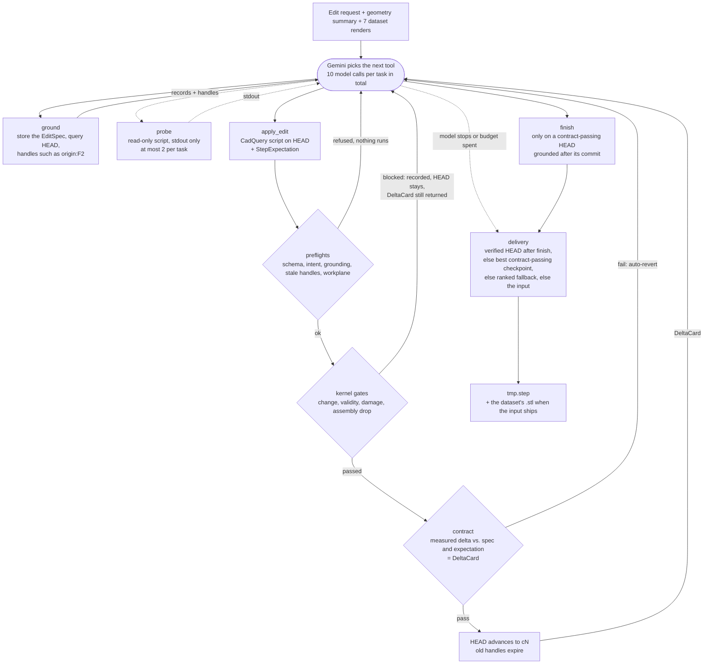

# IDETC 2026 Hackathon

# Autodesk neuralCAD-Edit Problem

This repo contains the code for the Autodesk neuralCAD-Edit hackathon problem, based on the 3D CAD editing dataset and benchmark introduced in the paper: [neuralCAD-Edit: An Expert Benchmark for Multimodal-Instructed 3D CAD Model Editing](https://autodeskailab.github.io/neuralCAD-Edit/)


## This fork: a grounded delta-contract CAD agent

Team *human-in-the-loop*'s entry to the IDETC 2026 neuralCAD-Edit hackathon. The agent edits a
STEP model from a text request with the same model and thinking level as the stock harness
(`gemini-3.7-flash`, medium), so the harness is the difference. It looks up the exact B-Rep faces
and edges it is about to change, declares what the edit must measurably do, and builds only on
checkpoints that pass that declaration. The B-Rep is the exact face, edge and solid model inside a
STEP file, as opposed to the triangle mesh of an STL.


*Figure 1. One request end to end (`B7A2N74ZJBF9MZHU_1770171700.697783`, medium). Panel (a) shows
the start part with section A–A. Panels (b)–(d) show the exact profile sections of the start, the
agent's commit c1 and the human edit, and the strip below lists the seven tool calls from ground to
finish (the two probes share one box). The `apply_edit` script behind c1 rebuilt the whole frame
from measured dimensions instead of editing the imported part, and the contract verified the result
([ARCHITECTURE §3](docs/ARCHITECTURE.md#a-real-run)); c1 matches the human edit within 0.001 mm.*

### The idea in four parts

| Part | Mechanism |
|---|---|
| **B-Rep graph** ("eyes") | `ground` returns measured records of the current state's faces and edges (type, area, centre, normal, radius) under handles bound to one revision, so the model reads geometry instead of guessing it from a render. |
| **CadQuery** ("hands") | Every edit is a CadQuery script that runs in a subprocess on the current checkpoint; a separate read-only worker answers numerical questions through printed output only. |
| **Git4CAD checkpoints** ("safety net") | Each result that differs from the input, from HEAD and from every earlier checkpoint is stored as a checkpoint; it becomes the base of the next edit only if the kernel gates pass: no newly invalid solid, no damage by shrinkage, no dropped assembly. |
| **The contract** ("checklist") | The model declares an EditSpec for the task and a StepExpectation per edit; the measured delta is checked against both and returned as a DeltaCard, and a failed required check moves HEAD back automatically. |

### The edit loop



The model's first call is `ground`: it stores the EditSpec and returns measured records of the
current HEAD with handles such as `origin:F2`. `apply_edit` runs one CadQuery script on HEAD, the
latest accepted state, passes the result through the kernel gates, measures it against the step's
expectation, and advances HEAD only when both checks pass. Each accepted commit makes the previous
handles stale, so the model has to `ground` again before `finish` is accepted. After an accepted
`finish` the delivered file is that verified HEAD; otherwise it is the best contract-passing
checkpoint, and failing that the best-ranked remaining candidate. When nothing was committed or
every candidate is damaged, the unmodified input ships together with the dataset's own `.stl`.
That mesh matters only on the three requests whose ground-truth edit changes nothing, and there
only when the agent delivers the unmodified input ([ARCHITECTURE §8](docs/ARCHITECTURE.md#8-delivery)).

### Results

| System (means over the 48 text requests) | Chamfer | Volume F1 | **Diff F1** | $/task |
|---|---:|---:|---:|---:|
| Unmodified input shipped as the answer (no-op reference) | 0.9710 | 0.8994 | 0.0625 | 0 |
| Stock CadQuery-script harness, `gemini-3.7-flash`, medium thinking, `prompt_history: last`¹ | 0.9740 | 0.9028 | 0.2824 | 0.08 |
| **Agent** (same model, same thinking level), hackathon submission | 0.9779 | 0.9176 | **0.4841** | 0.21 |
| Second human expert given the same request (the ceiling) | 0.9799 | 0.9058 | 0.5953 | – |

¹ Each iteration shows the model only the previous iteration's script, output and render; the
organisers' default keeps every earlier script and output in the prompt ([REPRODUCING §6](docs/REPRODUCING.md#6-the-stock-baseline)).

Read the table by **Diff F1**: it scores the *change* an edit made against the change the human
made, and it is the only metric the no-op does not saturate. Its ceiling is the second human's
score, not 1.0, because two engineers given the same request produce different, both-correct
geometry; provenance and per-difficulty numbers are in
[ARCHITECTURE §13](docs/ARCHITECTURE.md#13-results). A single 48-task run moves the Diff F1 mean by
about ±0.02, so the next step is five runs per system, reported as mean and spread per request.

### Quick start

```bash
uv sync          # Python 3.12, CadQuery, google-adk, pytest
uv run pytest    # ~3 min, no API key, no dataset needed
```

The agent on all 48 requests, from the repository root:

```bash
uv run python src/scripts_benchmark_inference/run_harness.py \
    --config src/config/edit_192_external.json \
    --input data/edit_192_external/parquets/val_edit_text.parquet \
    --output_dir data/model_outputs \
    --harness src/harnesses/cadquery_script.py \
    --userId gemini-3.7-flash_adk-agent-v4 \
    --required-extensions step --workers 4
```

The command needs the filtered dataset ([REPRODUCING §1](docs/REPRODUCING.md#1-dataset)) and Gemini
credentials ([§2](docs/REPRODUCING.md#2-credentials)); the same file covers a one-request smoke test
([§3](docs/REPRODUCING.md#3-run-the-agent)), scoring ([§4](docs/REPRODUCING.md#4-score)) and the
pitfalls ([§5](docs/REPRODUCING.md#5-pitfalls)).

### Where to go next

* [`docs/ARCHITECTURE.md`](docs/ARCHITECTURE.md) explains the mechanism piece by piece:
  [§0](docs/ARCHITECTURE.md#0-module-map) maps every agent module to its role,
  [§3](docs/ARCHITECTURE.md#3-one-task-step-by-step) follows one task step by step and ends with a
  real run, [§6](docs/ARCHITECTURE.md#6-the-contract-cad_contractpy) defines the contract,
  [§7](docs/ARCHITECTURE.md#7-checkpoints-and-gates-cad_gitpy-cad_toolspy) the checkpoint gates,
  and [§14](docs/ARCHITECTURE.md#14-using-another-model) shows how to use another model or provider.
* [`docs/REPRODUCING.md`](docs/REPRODUCING.md) carries every command, flag and caveat for the
  dataset, credentials, runs, scoring and the stock baseline.
* [`docs/CHANGES.md`](docs/CHANGES.md) lists every file this fork adds to or modifies in the
  organisers' code, with the agent code separated from configuration, tests and documentation.
* [`tests/test_v4_offline.py`](tests/test_v4_offline.py) drives the whole agent with a scripted
  model and no API key; read it to see exactly what the model receives on every call and what
  comes back.

---

## Benchmark documentation (the organisers' original README)

We provide:

- [The problem statement PDF.](./Autodesk%20One-Page-Problem-Statement-CIE-Hackathon_2026.pdf)
- [The introductory presentation.](https://myshare.autodesk.com/:p:/g/personal/daniele_grandi_autodesk_com/IQD7kvs0GxyuSqM06rkRUDT3AbySY50fq01jyq3KHc28XpY?e=ZSUQpi)
- [A dataset of 48 text-based editing requests and associated edits](https://myshare.autodesk.com/:u:/g/personal/daniele_grandi_autodesk_com/IQAT9e3wi76SQ6zqJX6uCAn_AQ-6SOrZbl44TW_GuRkJbXo?e=iDQ8CG).
- Code for accessing the data.
- Notebooks for visualising and analysing the data.
- Harness code which allows foundation models to perform edits with iterative cadquery script refinement.
- All outputs of the foundation models we run in the paper and report results on.
- All automatic, human and VLM evaluations.

Instructions are provided below, but please get in touch if you have any questions.

### Setup

1. Clone this repo
2. Install dependencies (recommended, cross-platform):

```bash
uv sync
```

Run scripts with `uv run python ...` or set `PYTHONPATH` to the repo root.

**Conda fallback** (macOS/Linux): `conda env create -f environment.yml`

**Config notes:**

- Set `models_dir.paths` in `src/config/edit_192_external.json` to your harness output directory before ingesting model results.
- The database uses the `breps` collection by default (`breps_collection` in config). Do not set it to `breps_v2` unless your data uses that collection.


### Download and visualise data

> **⚠️ Important:**  
> This hackathon problem uses data that is **significantly different** from the original dataset.  
>
> **Use the data linked below for this competition, do *not* use previous versions of the dataset.**

1. [Download the pre-computed database zip](https://myshare.autodesk.com/:u:/g/personal/daniele_grandi_autodesk_com/IQAT9e3wi76SQ6zqJX6uCAn_AQ-6SOrZbl44TW_GuRkJbXo?e=iDQ8CG) and extract it into `data/edit_192_external` (or another location and update `storage_dir` in `src/config/edit_192_external.json`). The slimmed hackathon dataset contains 48 text-conditioned edit requests with paper-matching DINO features, human GT edits, and foundation-model baselines.
2. To keep only text-conditioned requests in the database, run `uv run python src/scripts/filter_dataset_text_only.py --config src/config/edit_192_external.json`.
3. Try using `src/notebooks/visualise_examples.ipynb` to look at some of the data.


### Repo structure

- `src/config` - config jsons
- `src/harnesses` - contains the cadquery harness
- `src/notebooks` - notebook for visualising the database etc
- `src/scripts` - for running stages of the evaluation pipeline
- `src/scripts_benchmark_inference` - scripts to run a foundation model in a harness
- `src/scripts_groundtruth` - used to export/ingest for human labelling on AWS groundtruth
- `src/scripts_preprocess` - cadquery_convert.py for headless STEP to STL/PNG export
- `src/utils` - contains database, feature extraction, metric evaluation, and plotting utilities
- `src/vlms` - a base VLM class with provider specific files which inherit


### Running your own foundation model/harness

- You can either modify ours (see the cadquery harness in `src/vlms/base_vlm.py`, `src/harnesses/cadquery_script.py` and `src/scripts_benchmark_inference/run_harness.py` ). You can update model settings in the config, and an example of how to run is in `src/scripts/run_all.sh` (macOS/Linux) or `src/scripts/run_all.ps1` (Windows).
- Or you can write your own.
- Either way, you must produce a .step file and a settings.json with the appropriate data in. You can see what we do in `src/scripts_benchmark_inference/run_harness.py`
- You must also provide a single topright isometric view, and 6 orthographic views (top, bottom, front, back, left, right), and ensure they are in the correct file structure to be ingested. Additionally, some metrics require .stls. If the harness does not natively output these files, use `src/scripts_preprocess/cadquery_convert.py` to export them headless from `.step` files.
- An single example model output ready to be ingested is in `example_data`. As long as your model output matches this file/folder structure, it will be OK.
- Add your output path to `models_dir` in the config.
- Ingest and run the evaluation in `src/scripts/run_all.sh` (macOS/Linux) or `src/scripts/run_all.ps1` (Windows)
- You can then use `src/notebooks/leaderboard.ipynb` to display the results.
- Note that these give you the automatic metrics only. We'll gladly run the human evals for you.

### Metrics and outputs

The hackathon benchmark computes three automatic metrics (all in [0, 1], higher is better; failed or missing edits score **0.0**):

| Metric | Description |
|--------|-------------|
| **Chamfer similarity (norm)** | Scale-invariant Chamfer distance normalized by the ground-truth bounding-box diagonal |
| **Volume F1** | F1 between the GT and model output |
| **Diff F1** | F1 between the voxel diff (start → prediction) and the voxel diff (start → ground truth) |

The first two measures compare the final model output and the groundtruth edit, however we are measuring *edits*, not *generations*. Diff F1 compares the deltas-- i.e. it looks at the change in volume between the input model and edited model, and compares this with the change in the groundtruth edit.

Raw Chamfer, IoU, CLIP similarity, Dino similarity, and automatic VLM rating are **no longer computed** by the pipeline. Precomputed VLM and human ratings shipped with the dataset are still shown in `src/notebooks/leaderboard.ipynb`.

After pulling metric changes, **re-run the benchmark** so new rating keys are written to your local database (older databases only have the legacy metric keys).

To force recomputation after a metric definition change, set `"recompute_metrics": true` in `src/config/edit_192_external.json`.

Running `src/scripts/run_all_benchmarks.py` (via `run_all.sh` / `run_all.ps1`) writes:

- `data/edit_192_external/results/metric_bar_facets.png` — faceted bar chart of the three metrics across models (human baseline as a dashed reference line)
- `data/edit_192_external/results/cost_barplot.png` — mean estimated cost per edit per model
- `data/edit_192_external/results/all_results.json` — per-difficulty scores used by the plots

The cost plot scans all edits in the database; the pipeline calls `clean_db_single_edit_per_user_per_request()` first so duplicate edits do not skew the mean. If you ingest extra edits without re-running that cleanup step, cost stats may be inflated.


### Database Schema

The dataset/benchmark is organised in a local mongita database with the following schemas

- requests: contains all information about the request (text instruction, etc).
- edits: contains all the information about an edit (screengrabs, edit events, etc.)
- users: humans/ML models who have created requests, edits, or evaluations
- breps: contains all the information about a brep: .step, .stl, iso and 6-orthographic images, dino v2 features etc.
- ratings: ratings performed on an edit by a user

All objects (e.g. step files) live outside the database in the file tree, and are pointed to by their relative filepaths from the database. See `src/notebooks/visualise_examples.ipynb` for example access patterns.


### Citation

```bibtex
@inproceedings{perrett2026neuralcadedit,
  title={neuralCAD-Edit: An Expert Benchmark for Multimodal-Instructed 3D CAD Model Editing},
  author={Perrett, Toby and Bouchard, Matthew and McCarthy, William},
  booktitle={arXiv preprint arXiv:2604.16170},
  year={2026}
}
```

