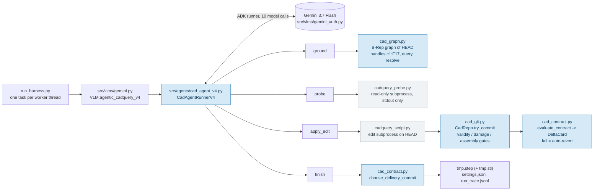

# IDETC 2026 Hackathon

# Autodesk neuralCAD-Edit Problem

This repo contains the code for the Autodesk neuralCAD-Edit hackathon problem, based on the 3D CAD editing dataset and benchmark introduced in the paper: [neuralCAD-Edit: An Expert Benchmark for Multimodal-Instructed 3D CAD Model Editing](https://autodeskailab.github.io/neuralCAD-Edit/)


## This fork: a grounded delta-contract CAD agent

Team *human-in-the-loop*'s entry. The agent edits a STEP model from a text request by
**looking up the geometry it is about to change** (a B-Rep graph whose face/edge handles are
scoped to one revision), **declaring what the edit must measurably do** (an *EditSpec* for the
task and a *StepExpectation* per step) and **keeping only states that pass that contract** on a
Git-style checkpoint history. It runs the same model at the same thinking level as the stock
harness; the harness is the difference. Everything that the agent needs is in this branch, the
code is covered by an offline test suite that runs the whole agent without an API key, and
[`docs/ARCHITECTURE.md`](docs/ARCHITECTURE.md) explains the mechanism piece by piece.

| System (means over the 48 text requests) | Chamfer | Volume F1 | **Diff F1** | $/task |
|---|---:|---:|---:|---:|
| Unmodified input shipped as the answer (no-op reference) | 0.9710 | 0.8994 | 0.0625 | 0 |
| Stock CadQuery-script harness, `gemini-3.7-flash`, medium thinking, `prompt_history: last` | 0.9740 | 0.9028 | 0.2824 | 0.08 |
| **Agent** (same model, same thinking level), hackathon submission | 0.9779 | 0.9176 | **0.4841** | 0.21 |
| Second human expert given the same request (the ceiling) | 0.9799 | 0.9058 | 0.5953 | – |

Read the table by **Diff F1**: it scores the *change* the edit made against the change the human
made, and it is the only metric the no-op does not already saturate. Its ceiling is 0.60, not 1.0,
because two engineers given the same request produce different, both-correct geometry. Per
difficulty the agent reaches 0.66 / 0.40 / 0.40 (easy / medium / hard) against the stock harness's
0.40 / 0.26 / 0.19 and the human's 0.87 / 0.42 / 0.50. The agent, the stock baseline and the human
row are output of the organisers' evaluator (`run_all_benchmarks.py`), computed locally; the no-op
reference was scored with the same three metric definitions on the dataset's own files. The
dataset ships no baseline under the current three metrics.

**Future work.** A single 48-task run moves by roughly ±0.02 on the Diff F1 mean, driven by a
handful of requests that swing by up to ±1.0 between otherwise identical runs. The next step is to
run the agent (and the baseline) five times and report the mean and spread per request instead of
one run.

### Quick start

```bash
uv sync                                   # Python 3.12, CadQuery, google-adk, pytest
uv run pytest                             # ~2.5 min, no API key, no dataset needed
```

All commands run from the repository root. `uv sync` installs the project in editable mode, so
the `src.*` imports resolve under `uv run`; a plain interpreter needs `PYTHONPATH=.`.

1. **Dataset** -- download the zip linked in the organisers' section below, extract it to
   `data/edit_192_external`, and run
   `uv run python src/scripts/filter_dataset_text_only.py --config src/config/edit_192_external.json`
   once; it writes the 48 text requests to `parquets/val_edit_text.parquet`.
2. **Credentials** -- put one of the two in a `.env` file in the repository root:

   ```
   GEMINI_API_KEY=...                       # public Gemini API (GOOGLE_API_KEY works too)
   # or
   GOOGLE_CLOUD_PROJECT=my-project          # Vertex AI; run `gcloud auth application-default login` once
   GOOGLE_CLOUD_LOCATION=global             # optional, default "global"
   ```

   Vertex AI always goes through a project: the SDK's `GOOGLE_GENAI_USE_VERTEXAI` flag and
   Vertex "Express mode" keys are deliberately not honoured, so a stray environment variable
   cannot switch backends silently.

   Then check that the model named in the config answers:

   ```bash
   uv run python src/scripts/check_gemini_access.py --userId gemini-3.7-flash_adk-agent-v4
   ```

3. **Run the agent** on all 48 requests. The run is resumable: every task that already has a
   `settings.json` is skipped, including failed ones. To retry failures run once with
   `--remove_failed`, which deletes output folders without a `tmp.step` after the batch, then
   run again.

   ```bash
   uv run python src/scripts_benchmark_inference/run_harness.py \
       --config src/config/edit_192_external.json \
       --input data/edit_192_external/parquets/val_edit_text.parquet \
       --output_dir data/model_outputs \
       --harness src/harnesses/cadquery_script.py \
       --userId gemini-3.7-flash_adk-agent-v4 \
       --required-extensions step --workers 4
   ```

   On Windows PowerShell replace the trailing `\` with a backtick or put the command on one line
   (`src/scripts/run_all.ps1` shows the PowerShell form). Each task lands in `data/model_outputs/cadquery_script/<userId>/val_edit_text/<edit_id>/brep_end/<t>/`
   with `tmp.step`, `settings.json` (every counter, the contract verdicts, the tool-call log) and
   `iteration_output/` (every attempt's script, stdout and STEP, every checkpoint, `run_trace.jsonl`).
   The stock baseline is the same command with `--userId gemini-3.7-flash_cadquery-script`.
4. **Score** with the organisers' pipeline (STL + seven views, ingest, metrics):

   ```bash
   uv run python src/scripts_preprocess/cadquery_convert.py data/model_outputs/cadquery_script/gemini-3.7-flash_adk-agent-v4
   uv run python src/scripts/build_instructions_db.py --config src/config/edit_192_external.json
   uv run python src/scripts/run_all_benchmarks.py --config src/config/edit_192_external.json
   ```

   Run the conversion exactly like this, never with `--no-skip`: that re-exports and overwrites the
   dataset `.stl` the agent ships on unchanged tasks (`--views-only` re-renders without touching
   meshes). Results: `data/edit_192_external/results/all_results.json` and the two plots next to it.
   `run_all_benchmarks.py` first deletes every non-latest edit per (request, user) from the local
   database, so back up `data/edit_192_external/mongita_db` before experimenting.

   On Windows keep the clone's path short: the metric code opens meshes with open3d, which cannot
   read a path of 260 or more characters, and a task's output path under `data/model_outputs`
   already takes about 190 of them on its own.

### How a task runs



The model's first action is `ground`: it stores the EditSpec and gets back a small neighbourhood
of the current HEAD with handles such as `origin:F2`. `apply_edit` runs one CadQuery script on
HEAD (never on the original), passes it through the kernel gates, measures the result against the
expectation it was given, and either advances HEAD or reverts. After every accepted commit the
handles expire, so the model has to `ground` again before it may `finish`. The delivered file is
the best contract-passing checkpoint; if nothing was committed, the unmodified input ships together
with the dataset's own `.stl` (that detail alone decides three of the 48 requests).

### Where to read

| File | Role | Start here if you want to... |
|---|---|---|
| [`src/agents/cad_agent_v4.py`](src/agents/cad_agent_v4.py) | **The agent.** System prompt, the four tools, the message loop, the delivery choice | change what the agent does or says |
| [`src/agents/cad_contract.py`](src/agents/cad_contract.py) | EditSpec / StepExpectation normalisation, preflights, `evaluate_contract` -> DeltaCard, delivery ranking. Pure Python, no CadQuery | add or change a contract metric |
| [`src/agents/cad_graph.py`](src/agents/cad_graph.py) | `BRepGraph`: revision-scoped handles, filtered queries, adjacency, mating features | change what `ground` can see |
| [`src/agents/cad_git.py`](src/agents/cad_git.py) | Git4CAD: checkpoints, the pre-commit gates, revert, `final_step` fallback ranking | change when a state becomes HEAD |
| [`src/agents/cad_tools.py`](src/agents/cad_tools.py) | Geometry fingerprint (`summarise_shape`), change/damage tests, the two subprocess workers | change how geometry is measured |
| [`src/agents/cad_agent_base.py`](src/agents/cad_agent_base.py) | Model object, generation config, the fixed between-turn messages | swap the model or its settings |
| [`src/agents/cad_trace.py`](src/agents/cad_trace.py), [`cad_render.py`](src/agents/cad_render.py) | ADK plugin writing `run_trace.jsonl`; optional red/green diff renderer (off in the shipped config) | debug a run / turn renders on |
| [`src/vlms/gemini_auth.py`](src/vlms/gemini_auth.py), [`gemini.py`](src/vlms/gemini.py) | Credentials (one place for harness and agent); the stock loop and the agent dispatch | fix authentication |
| [`src/harnesses/`](src/harnesses) | `cadquery_script.py` (organisers' edit worker, + `--skip_render`) and `cadquery_probe.py` (read-only worker) | change what a script may do |
| [`src/config/edit_192_external.json`](src/config/edit_192_external.json) | `benchmark_models` entries `gemini-3.7-flash_adk-agent-v4` and `gemini-3.7-flash_cadquery-script`; the key is the userId | change budgets, seed, model, features |
| [`tests/test_v4_offline.py`](tests/test_v4_offline.py) | The whole agent driven by a scripted model (`tests/fake_llm.py`): happy path, contract failure and revert, stale handles, budgets, transport retry | see exactly what the model is shown and what comes back |

### Using another model

* **Another Gemini model or thinking level**: edit `model` / `thinking_level` in the config entry.
  `seed` is forwarded to the API; `max_turns` is the total number of model calls per task.
* **Another provider for the agent**: the agent talks to the model through Google ADK, so it needs
  a `google.adk.models.BaseLlm`. Override `CadAgentRunnerBase._model()` (in
  `src/agents/cad_agent_base.py`) to return, for example, ADK's `LiteLlm("openai/<model>")`
  (`uv add litellm`), and adapt `_generation_config()`, whose `thinking_config` and
  `safety_settings` are Gemini-specific. `tests/fake_llm.py` is the smallest working `BaseLlm`
  and shows the request/response contract the agent relies on: function-call parts in, a dict per
  tool back, `usage_metadata` on every response.
* **Another provider for the stock harness**: add `src/vlms/<family>.py` exporting a class named
  `VLM(BaseVLM)` (see `openai.py`, `anthropic.py`) and reference it as `family` in the config.
* **The stock harness's prompt layout**: `prompt_history` on a config entry selects `"full"`
  (the organisers' growing-context loop, the default) or `"last"` (only the previous iteration's
  feedback is shown; the gemini-3.7-flash baseline above was produced with this variant).

### Reproducibility notes

* `thinking_level: medium` with `seed` is near-deterministic on about half of the requests and not
  on the rest; a single 48-task run cannot resolve differences below roughly ±0.02 Diff F1.
* All three metrics are computed on the STL in the input frame without registration; any
  translation or rotation of the part costs the full score. Chamfer has ~0.004 sampling noise.
* Three of the 48 ground-truth edits are voxel-identical to the start; there, only the dataset's
  own `.stl` scores 1.0, a re-tessellated copy of the same STEP scores 0.0. The agent ships the
  original mesh whenever it delivers the unmodified input.

---

## Benchmark documentation (the organisers' original README)

We provide:

- [The problem statement PDF.](./Autodesk%20One-Page-Problem-Statement-CIE-Hackathon_2026.pdf)
- [The introductory presentation.](https://myshare.autodesk.com/:p:/g/personal/daniele_grandi_autodesk_com/IQD7kvs0GxyuSqM06rkRUDT3AbySY50fq01jyq3KHc28XpY?e=ZSUQpi)
- [A dataset of 48 text-based editing requests and associated edits](https://myshare.autodesk.com/:u:/g/personal/daniele_grandi_autodesk_com/IQAT9e3wi76SQ6zqJX6uCAn_AQ-6SOrZbl44TW_GuRkJbXo?e=iDQ8CG).
- Code for accessing the data.
- Notebooks for visualising and analysing the data.
- Harness code which allows foundation models to perform edits with iterative cadquery script refinement.
- All outputs of the foundation models we run in the paper and report results on.
- All automatic, human and VLM evaluations.

Instructions are provided below, but please get in touch if you have any questions.

### Setup

1. Clone this repo
2. Install dependencies (recommended, cross-platform):

```bash
uv sync
```

Run scripts with `uv run python ...` or set `PYTHONPATH` to the repo root.

**Conda fallback** (macOS/Linux): `conda env create -f environment.yml`

**Config notes:**

- Set `models_dir.paths` in `src/config/edit_192_external.json` to your harness output directory before ingesting model results.
- The database uses the `breps` collection by default (`breps_collection` in config). Do not set it to `breps_v2` unless your data uses that collection.


### Download and visualise data

> **⚠️ Important:**  
> This hackathon problem uses data that is **significantly different** from the original dataset.  
>
> **Use the data linked below for this competition, do *not* use previous versions of the dataset.**

1. [Download the pre-computed database zip](https://myshare.autodesk.com/:u:/g/personal/daniele_grandi_autodesk_com/IQAT9e3wi76SQ6zqJX6uCAn_AQ-6SOrZbl44TW_GuRkJbXo?e=iDQ8CG) and extract it into `data/edit_192_external` (or another location and update `storage_dir` in `src/config/edit_192_external.json`). The slimmed hackathon dataset contains 48 text-conditioned edit requests with paper-matching DINO features, human GT edits, and foundation-model baselines.
2. To keep only text-conditioned requests in the database, run `uv run python src/scripts/filter_dataset_text_only.py --config src/config/edit_192_external.json`.
3. Try using `src/notebooks/visualise_examples.ipynb` to look at some of the data.


### Repo structure

- `src/config` - config jsons
- `src/harnesses` - contains the cadquery harness
- `src/notebooks` - notebook for visualising the database etc
- `src/scripts` - for running stages of the evaluation pipeline
- `src/scripts/benchmark_inference` - scripts to run a foundation model in a harness
- `src/scripts_grundtruth` - used to export/ingest for human labelling on AWS groundtruth
- `src/scripts_preprocess` - cadquery_convert.py for headless STEP to STL/PNG export
- `src/utils` - contains database, feature extraction, metric evaluation, and plotting utilities
- `src/vlms` - a base VLM class with provider specific files which inherit


### Running your own foundation model/harness

- You can either modify ours (see the cadquery harness in `src/vlms/base_vlm.py`, `src/harnesses/cadquery_script.py` and `src/scripts_benchmark_inference/run_harness.py` ). You can update model settings in the config, and an example of how to run is in `src/scripts/run_all.sh` (macOS/Linux) or `src/scripts/run_all.ps1` (Windows).
- Or you can write your own.
- Either way, you must produce a .step file and a settings.json with the appropriate data in. You can see what we do in `src/scripts_benchmark_inference/run_harness.py`
- You must also provide a single topright isometric view, and 6 orthographic views (top, bottom, front, back, left, right), and ensure they are in the correct file structure to be ingested. Additionally, some metrics require .stls. If the harness does not natively output these files, use `src/scripts_preprocess/cadquery_convert.py` to export them headless from `.step` files.
- An single example model output ready to be ingested is in `example_data`. As long as your model output matches this file/folder structure, it will be OK.
- Add your output path to `models_dir` in the config.
- Ingest and run the evaluation in `src/scripts/run_all.sh` (macOS/Linux) or `src/scripts/run_all.ps1` (Windows)
- You can then use `src/notebooks/leaderboard.ipynb` to display the results.
- Note that these give you the automatic metrics only. We'll gladly run the human evals for you.

### Metrics and outputs

The hackathon benchmark computes three automatic metrics (all in [0, 1], higher is better; failed or missing edits score **0.0**):

| Metric | Description |
|--------|-------------|
| **Chamfer similarity (norm)** | Scale-invariant Chamfer distance normalized by the ground-truth bounding-box diagonal |
| **Volume F1** | F1 between the GT and model output |
| **Diff F1** | F1 between the voxel diff (start → prediction) and the voxel diff (start → ground truth) |

The first two measures compare the final model output and the groundtruth edit, however we are measuring *edits*, not *generations*. Diff F1 compares the deltas-- i.e. it looks at the change in volume between the input model and edited model, and compares this with the change in the groundtruth edit.

Raw Chamfer, IoU, CLIP similarity, Dino similarity, and automatic VLM rating are **no longer computed** by the pipeline. Precomputed VLM and human ratings shipped with the dataset are still shown in `src/notebooks/leaderboard.ipynb`.

After pulling metric changes, **re-run the benchmark** so new rating keys are written to your local database (older databases only have the legacy metric keys).

To force recomputation after a metric definition change, set `"recompute_metrics": true` in `src/config/edit_192_external.json`.

Running `src/scripts/run_all_benchmarks.py` (via `run_all.sh` / `run_all.ps1`) writes:

- `data/edit_192_external/results/metric_bar_facets.png` — faceted bar chart of the three metrics across models (human baseline as a dashed reference line)
- `data/edit_192_external/results/cost_barplot.png` — mean estimated cost per edit per model
- `data/edit_192_external/results/all_results.json` — per-difficulty scores used by the plots

The cost plot scans all edits in the database; the pipeline calls `clean_db_single_edit_per_user_per_request()` first so duplicate edits do not skew the mean. If you ingest extra edits without re-running that cleanup step, cost stats may be inflated.


### Database Schema

The dataset/benchmark is organised in a local mongita database with the following schemas

- requests: contains all information about the request (text instruction, etc).
- edits: contains all the information about an edit (screengrabs, edit events, etc.)
- users: humans/ML models who have created requests, edits, or evaluations
- breps: contains all the information about a brep: .step, .stl, iso and 6-orthographic images, dino v2 features etc.
- ratings: ratings performed on an edit by a user

All objects (e.g. step files) live outside the database in the file tree, and are pointed to by their relative filepaths from the database. See `src/notebooks/visualise_examples.ipynb` for example access patterns.


### Citation

```bibtex
@inproceedings{perrett2026neuralcadedit,
  title={neuralCAD-Edit: An Expert Benchmark for Multimodal-Instructed 3D CAD Model Editing},
  author={Perrett, Toby and Bouchard, Matthew and McCarthy, William},
  booktitle={arXiv preprint arXiv:2604.16170},
  year={2026}
}
```

