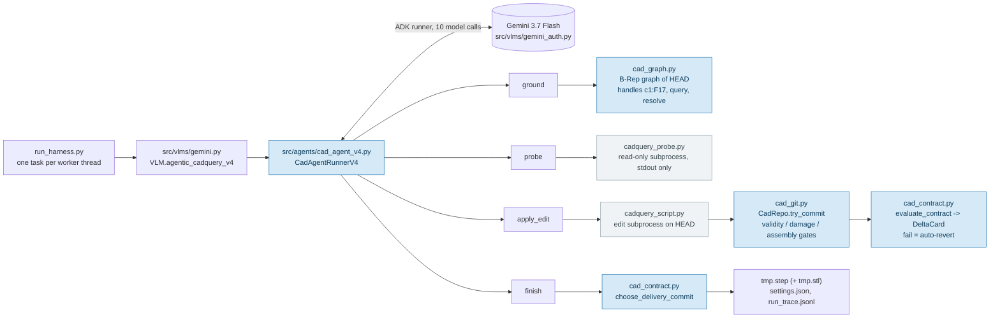
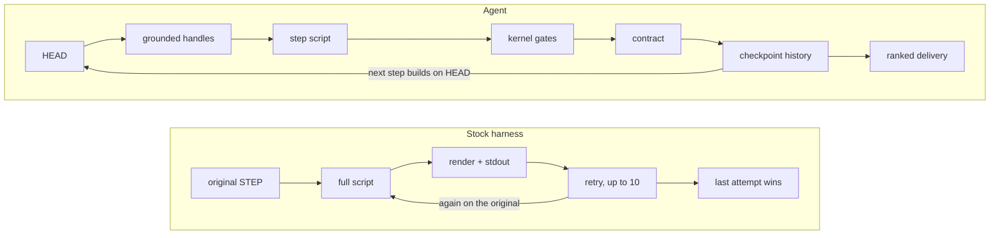
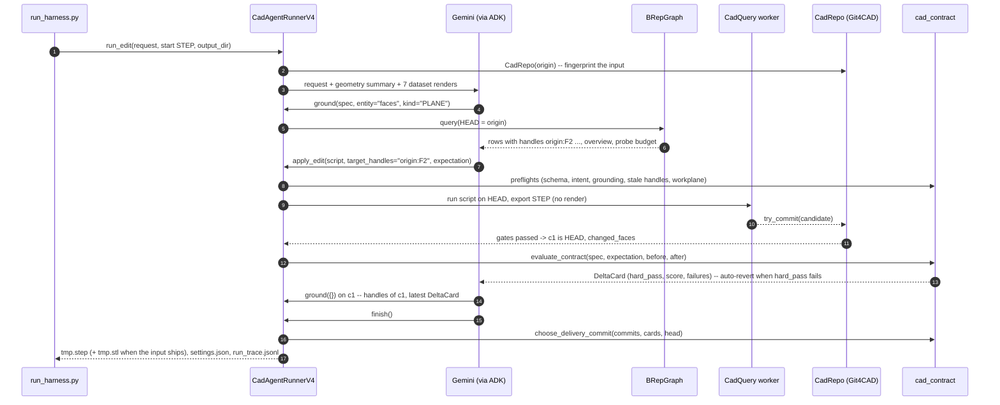
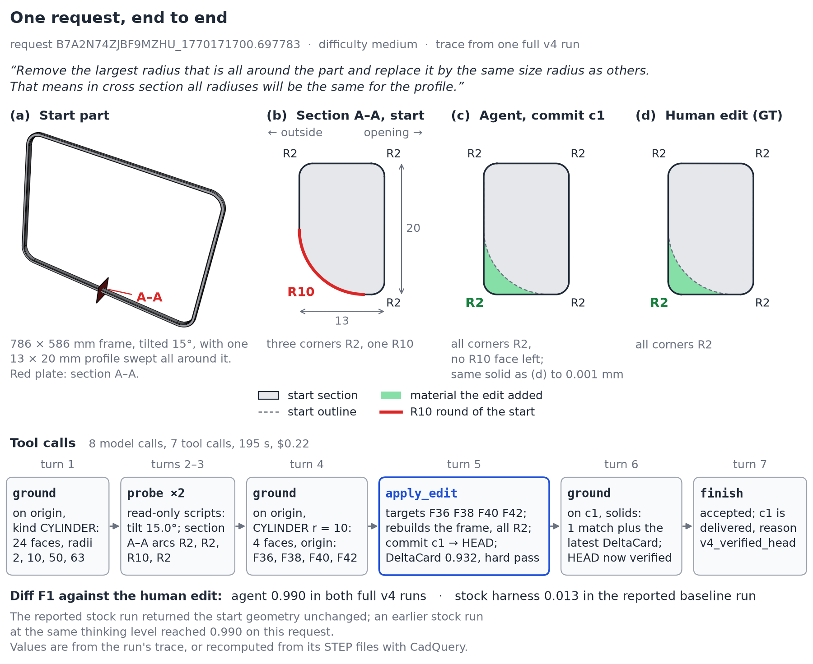

# The grounded delta-contract CAD agent

How the agent works, why the stock harness struggles, and where each mechanism lives in the code.
Paths are relative to the repository root; `file:function` names are the exact ones to read.

## 0. Module map

One task passes from the harness through the Gemini entry point into the runner, whose four tools
call the geometry modules (agent modules in blue, subprocess workers in grey).



### Where to read

| File | Role | Start here if you want to... |
|---|---|---|
| [`src/agents/cad_agent_v4.py`](../src/agents/cad_agent_v4.py) | **The agent.** System prompt, the four tools, the message loop, the delivery choice | change what the agent does or says |
| [`src/agents/cad_contract.py`](../src/agents/cad_contract.py) | EditSpec / StepExpectation normalisation, preflights, `evaluate_contract` -> DeltaCard, delivery ranking. Pure Python, no CadQuery | add or change a contract metric |
| [`src/agents/cad_graph.py`](../src/agents/cad_graph.py) | `BRepGraph`: revision-scoped handles, filtered queries, adjacency, mating features | change what `ground` can see |
| [`src/agents/cad_git.py`](../src/agents/cad_git.py) | Git4CAD: checkpoints, the pre-commit gates, revert, `final_step` fallback ranking | change when a state becomes HEAD |
| [`src/agents/cad_tools.py`](../src/agents/cad_tools.py) | Geometry fingerprint (`summarise_shape`), change/damage tests, the launchers for the edit and probe workers (`run_cadquery_script`, `run_probe_script`) | change how geometry is measured |
| [`src/agents/cad_agent_base.py`](../src/agents/cad_agent_base.py) | Model object, generation config, the fixed between-turn messages | swap the model or its settings (section 14) |
| [`src/agents/cad_trace.py`](../src/agents/cad_trace.py), [`cad_render.py`](../src/agents/cad_render.py) | ADK plugin writing `run_trace.jsonl`; optional red/green diff renderer (off in the shipped config) | debug a run / turn renders on |
| [`src/vlms/gemini_auth.py`](../src/vlms/gemini_auth.py), [`gemini.py`](../src/vlms/gemini.py) | Credentials (one place for harness and agent); the single Gemini request of the stock loop (`generate_response`; the loop itself is `BaseVLM.visual_update_loop` in `src/vlms/base_vlm.py`) and the agent dispatch (`agentic_cadquery_v4`) | fix authentication |
| [`src/harnesses/`](../src/harnesses) | `cadquery_script.py` (organisers' edit worker, + `--skip_render`) and `cadquery_probe.py` (read-only worker) | change what a script may do |
| [`src/config/edit_192_external.json`](../src/config/edit_192_external.json) | `benchmark_models` entries `gemini-3.7-flash_adk-agent-v4` and `gemini-3.7-flash_cadquery-script`; the key is the userId | change budgets, seed, model, features |
| [`tests/test_v4_offline.py`](../tests/test_v4_offline.py) | The whole agent driven by a scripted model (`tests/fake_llm.py`): happy path, contract failure and revert, stale handles, budgets, transport retry | see exactly what the model is shown and what comes back |

## 1. The four-part mental model

| Part | Module | What it gives the model |
|---|---|---|
| **The B-Rep graph** ("eyes") | `src/agents/cad_graph.py` | Exact face and edge records of the *current* state -- type, area, centre, normal, radius, axis -- addressed by handles such as `c1:F17`, with adjacency and mating-feature detection. The model never has to guess coordinates from a 2D render. |
| **CadQuery** ("hands") | `src/harnesses/cadquery_script.py`, `src/agents/cad_tools.py` | The model's script runs in a subprocess on the current HEAD and exports a STEP. A second, read-only worker (`cadquery_probe.py`) answers numerical questions with stdout only. |
| **Git4CAD** ("safety net") | `src/agents/cad_git.py` | A commit history over B-Rep states. A changed candidate becomes HEAD only if it passes the kernel gates; one that fails them is still recorded for delivery, but the next script builds on the last good state. A result identical to the input, to HEAD or to an earlier commit is refused and not recorded (section 7). `revert` moves HEAD back. |
| **The contract** ("checklist") | `src/agents/cad_contract.py` | The model declares an *EditSpec* for the task and a *StepExpectation* per edit; after each commit the measured delta is checked against both and summarised as a *DeltaCard*. A failed required assertion reverts HEAD automatically. |

`src/agents/cad_agent_v4.py` ties the four together: it defines the tools `ground`, `probe`,
`apply_edit`, `finish`, the system prompt, the message loop and the delivery choice.
`src/agents/cad_agent_base.py` holds what is independent of the tools: the model object, the
generation config, the sync entry point and the fixed messages the loop sends between turns.

## 2. Stock harness versus the agent

The organisers' harness (`BaseVLM.visual_update_loop` in `src/vlms/base_vlm.py`) asks the model
for a complete CadQuery function, runs it on the **original** STEP, shows the model one render and
the program output, and repeats up to ten times; the last export is the answer. The agent instead
takes small steps on a checkpointed HEAD and checks each one before it may become the next base:



| Problem in the stock loop | Why it happens | What the agent does instead |
|---|---|---|
| Every iteration starts from the original part | the script always receives the original STEP | `args['input_file']` is HEAD, so iteration seven is the seventh *step*, not the seventh fresh attempt |
| The model guesses coordinates, radii and face orientation from a render | no structural view of the B-Rep | `ground` returns measured face/edge records with handles, filtered by type, radius, position or neighbourhood |
| A face index means something else after every export | STEP export renumbers faces | handles carry the revision (`origin:F2`, `c1:F4`); a stale handle is refused before the script runs (`cad_graph.py:BRepGraph.resolve`) |
| An assembly loses components when the script returns only the part it edited | `result.val()` exports the first object on the stack | the commit gate blocks HEAD on the assembly-drop signature -- most solids gone *and* most of the input's faces gone (`cad_git.py:assess_commit`); the prompt insists on reassembling |
| "Add a hole" is satisfied by moving an existing one | nothing checks the intent | `cad_contract.py:infer_request_intent` + `operation_preflight_issue` block a transform-only edit for a creation request |
| `fillet()` / `chamfer()` return broken geometry without raising | an OCC property, radius -> success is not monotonic | every result is checked with `isValid()`; invalidity the edit introduced blocks HEAD, invalidity the input already had does not (3 of the 48 start models are invalid) |
| A late bad attempt overwrites a good early one | last-wins export | delivery ranks all candidates: contract-passing, valid, undamaged first (`cad_contract.py:choose_delivery_commit`, fallback `cad_git.py:select_final`) |
| Turns are spent on print-only scripts | the only tool is "run a script" | `probe` is a separate, cheap, budgeted read-only tool; `ground` answers most questions without a script |

## 3. One task, step by step



`finish` refuses when there is no contract-passing HEAD or when the current HEAD has not been
grounded after its commit. Without `finish`, a run that committed something ends as
`agent_completed` if its last text contains one of the `DONE_MARKERS` (section 12), as
`agent_stopped_with_result` if it stops without one, as `max_turns_reached` if the call limit
ends it, or as `error_after_commit` on a permanent error or once the transport retries are spent.
In every case delivery falls
back to the contract ranking. With nothing committed after two nudges, the unmodified input ships
with the dataset's `.stl` next to it. `termination_reason` is then `no_valid_edit`; the loop's own
default label, `max_turns_reached`, survives only in `agent_stop_signal` (section 10).

### A real run

Request `B7A2N74ZJBF9MZHU_1770171700.697783` (medium), traced in one full v4 run:

> Remove the largest radius that is all around the part and replace it by the same size radius as others. That means in cross section all radiuses will be the same for the profile.



The part is a 786 × 586 mm frame, tilted 15°, with a 13 × 20 mm profile swept around it. Three
profile corners are R2 and one is R10.

| turn | call | reply |
|---|---|---|
| 1 | `ground(entity="faces", kind="CYLINDER", spec=…)` on origin | 24 matches (R2 ×12, R10, R50, R63 ×4 each), 12 rows shown |
| 2–3 | `probe` ×2 | tilt 15.0°; a section at x = −556.62 gives arcs R2, R2, R10, R2 |
| 4 | `ground(kind="CYLINDER", radius=10, spec=…)` | 4 matches: `origin:F36`, `F38`, `F40`, `F42` |
| 5 | `apply_edit(script, target_handles="origin:F38,origin:F42,origin:F36,origin:F40", expectation=…)` | c1 committed, HEAD advanced, DeltaCard below |
| 6 | `ground(entity="solids", spec=…)` on c1 | 1 match plus `latest_delta_card` |
| 7 | `finish(reason=…)` | accepted |

Below are the EditSpec the turn-4 call stored (normalised) and two of the rows that call returned.
The trace records arguments, not replies, so these rows and the DeltaCard below were recomputed from
the run's STEP files with the repository's code; they reproduce the recorded match counts,
contract score and preserved ratio:

```json
{"operation": "modify", "target_description": "10mm cylinder fillets of the profile",
 "assertions": [{"metric": "solid_delta", "operator": "eq", "value": 0, "required": true},
                {"metric": "volume_delta", "operator": "gt", "value": 0, "required": true}],
 "preservation": {"keep_solid_count": true, "min_preserved_ratio": 0.8}, ...}
{"handle": "origin:F38", "type": "CYLINDER", "radius": 10.0, "area": 10367.256,
 "center": [-556.62, -490.399, 29.004], "axis": [-1.0, 0.0, 0.0], ...}
{"handle": "origin:F36", "type": "CYLINDER", "radius": 10.0, "area": 7225.663,
 "center": [-167.254, -415.505, 308.51], "axis": [-0.0, -0.259, -0.966], ...}
```

StepExpectation passed to `apply_edit`:

```json
{"operation": "modify",
 "expected_changes": [{"metric": "solid_delta", "operator": "eq", "value": 0, "required": true},
                      {"metric": "volume_delta", "operator": "gt", "value": 0, "required": true}],
 "forbidden_changes": [], "preservation": {"min_preserved_ratio": 0.8, "keep_solid_count": true}}
```

The script never reads `args['input_file']`. It rebuilds the frame from dimensions in the initial
geometry summary and in the `ground` and `probe` replies, then fillets every top and bottom edge
at R2. The commit reports 17 faces added and 17 removed: the four R10 rounds and their four corner
tori, plus the faces they border (four outer-wall planes, the four R63 outer corners and one flat
face). The other 33 of 50 faces match the input, so the rebuild reproduced the rest of the frame.
DeltaCard for c1:

- `hard_pass: true`, `contract_score: 0.932` = 0.6 × (4/4 assertions passed: the EditSpec's two,
  repeated by the StepExpectation) + 0.2 × (4/4 target handles changed) + 0.2 × preserved ratio
  0.66 (`cad_contract.py:evaluate_contract`).
- Measured: `volume_delta` +54 004.22 mm³ (expected > 0), `solid_delta` 0 (expected 0), face and
  edge delta 0, bbox size +[0, 1.797, 1.798].
- The preserved ratio of 0.66 falls below the declared 0.8. The card records
  `min_preserved_ratio_passed: false`, but this is not a failure, because the preservation clause
  was not marked `required`.
- `recommendation`: "The deterministic delta contract is satisfied; finish if all request items
  are complete."

The finish reason was: "Successfully removed the 10mm fillet from the profile and replaced it with
a 2mm fillet so that all radii in the profile cross section are uniform (radius 2.0)." Delivery
records `final_source: contract_commit_c1`, `selection_reason: v4_verified_head` and
`termination_reason: agent_completed`. The run took 8 model calls, 7 tool calls, 195 s and $0.22.

c1 has no face of radius 10 left. A boolean comparison with 0.001 mm tolerance finds no difference
between c1 and the human edit, and the request scores Diff F1 0.990; the missing 0.01 is the
difference between CadQuery's and Fusion's triangulation of the same solid. `settings.json` →
`edit_spec` holds the spec from the turn-6 call, which overwrote the one above; the DeltaCard was
evaluated against the turn-4 spec.

## 4. The tools

| Tool | Arguments | What it returns | Cost |
|---|---|---|---|
| `ground(spec, entity, kind, solid, near, radius, min_measure, limit, seed_handles, depth)` | an EditSpec (may be `{}` after the first call) and filters | up to `limit` records of HEAD with handles (default 12, capped at 24); `overview`; the stored `edit_spec`; `request_intent`; probe budget; on a committed HEAD also `latest_delta_card` | one model call |
| `probe(script)` | a CadQuery script, top-level code is auto-wrapped | stdout only; no STEP, no render, no commit | one model call, at most `features.max_probe_calls` per task (1 on profile-substitution requests) |
| `apply_edit(script, target_handles, expectation)` | script, handles from `ground` on the current revision, a StepExpectation | `committed`, `head_advanced`, `head`, `delta_card`, `changed_faces`, `problems`, `kernel_notes`, stdout tail; or a refusal with `reason` (the four preflights add `correction`, a stale handle adds `handle_errors`, a commit-gate refusal adds `git_log`) | one model call plus one subprocess |
| `finish(reason)` | -- | `ok`, `selected_candidate` or a refusal | one model call |

`max_turns` in the config is the **total** model-call budget (`RunConfig.max_llm_calls`); every
tool round-trip is one call. An earlier version gave lookups their own allowance and the model
simply spent it; making every call cost the same is what makes `ground` compete with `apply_edit`
on merit.

Requests that read as a *profile substitution* (`cad_contract.py:infer_request_intent`: a
profile / cross-section word together with change / convert / replace / turn / transform ...
into / to / with) take a special path: the probe budget drops to one, the first message carries an
extra "Profile substitution detected" paragraph, the first `ground` on a multi-solid part returns
`mating_feature_pairs` even when `entity` was not `solids`, two extra preflights apply
(section 5), and a dimension-free substitution that changes any single solid's volume by more than
65 % fails the contract.

## 5. Handles, graph and preflights (`cad_graph.py`, `cad_contract.py`)

A `BRepGraph` is built from one STEP snapshot: faces `F<i>`, edges `E<i>`, solids `S<i>` are
numbered in OCC enumeration order and prefixed with the revision (`origin`, `c1`, `c2`, ...).
`query` filters by entity, analytic type (`PLANE`, `CYLINDER`, `CIRCLE`, ...), solid, position
(`near="x,y,z[,r]"`), radius, minimum measure, and can expand a neighbourhood around seed handles
(`depth` 0-3). When the query asks for solids and the part has at most four of them (or a
specific solid is named), the solid rows carry `axial_feature_spans`, and `mating_feature_pairs` lists equal-radius cylinders shared across solids (a pin in a hole).

`resolve(handle)` refuses any handle whose revision is not the current HEAD with a
`stale_handle` error. `apply_edit` resolves every target handle before it runs the script, so
the model can never cut on a face that no longer exists under that name.

Before the script runs, four preflights can refuse without spending an attempt:

1. `expectation_schema_issue` -- `expected_changes` / `forbidden_changes` must be assertion
   objects, never prose.
2. `operation_preflight_issue` -- a request that says add / create / copy / duplicate / insert
   must not be answered by a transform-only expectation.
3. `target_preflight_issue` -- profile substitutions must ground the local faces first.
4. `script_preflight_issue` -- named workplanes (`Workplane("XZ")`) are refused for profile
   edits because their normals can invert bounded coordinates; explicit `cq.Plane(...)` is required.

## 6. The contract (`cad_contract.py`)

An **EditSpec** is stored once per task: `operation` (add, remove, modify, transform, copy,
pattern, assembly, composite, edge_finish), `target_description`, `assertions`, `preservation`
and `completion_criteria`. A **StepExpectation** accompanies every `apply_edit`:
`expected_changes`, `forbidden_changes`, `preservation`.

Assertions have the shape `{metric, operator, value, tolerance, required}`. Metrics are measured
between the fingerprint of the parent state and the candidate: `volume_delta`, `volume_ratio`,
`solid_delta`, `face_delta`, `edge_delta`, `bbox_{x,y,z}_delta`, `center_{x,y,z}_delta`,
`face_type_delta:<TYPE>`, `circle_radius_count_delta:<r>`. Operators: `eq ne gt ge lt le between
nonzero`. Preservation rules: `min_preserved_ratio` (the share of the *original input's* faces
still found in the candidate, matched on surface type, area and centre -- origin-relative even on
a multi-step edit, so a second step that keeps every HEAD face still carries the first step's
losses), `keep_solid_count`, `allow_global_transform`, `max_translation_ratio`.

`evaluate_contract` produces a **DeltaCard**: every assertion with its measured value and
verdict, `hard_pass` (no failure among the required assertions, the required preservation rules,
the structural-delta requirement for add / remove / copy / pattern / edge_finish operations, and
the per-solid volume check on dimension-free profile substitutions), a `contract_score` in [0, 1],
`target_change` (did the grounded handles actually change?), `observed_delta` and a one-line
`recommendation`. A card that fails `hard_pass` on a commit that had become HEAD triggers
`repo.revert` to the previous HEAD. The commit is then *abandoned*: its STEP stays under
`iteration_output/repo/`, it is excluded from the contract ranking, and `final_step` reconsiders
it only when no live commit remains. The same revert abandons every later commit, and when HEAD
was still the original input it abandons every commit on record.

The contract is checked between two summaries of the agent's own geometry. It never sees the
ground truth, so it behaves identically on a scored request and on an unseen part.

## 7. Checkpoints and gates (`cad_git.py`, `cad_tools.py`)

`CadRepo.try_commit` fingerprints the candidate (`cad_tools.summarise_shape`: volume, centroid,
bounding box, face/edge/solid counts, radius histogram, per-face records, per-solid structure)
and applies, in order:

1. **Origin identity** -- a candidate geometrically identical to the original input is refused
   outright: exporting it would undo every edit and score 0.0 on Diff F1.
2. **HEAD identity** -- a candidate geometrically identical to the current HEAD is refused and
   nothing is recorded; the model is told the operation did not take effect.
3. **Duplicate** -- a candidate identical to an earlier, non-HEAD commit is reported as a repeat
   (`duplicate_of`) and not committed again.
4. **Relative validity** -- `isValid()` is evidence, not truth: invalidity the input already had
   is tolerated, invalidity the edit introduced blocks HEAD.
5. **Assembly drop** -- all gates compare against the original input, not the parent commit. HEAD
   is blocked only on the drop signature: solids were lost, more than half of the input's solids
   are gone, and fewer than 50 % of the input's faces survive. A plain solid loss (one component
   removed, as three requests ask for) is reported to the model as a note, may become HEAD, and
   only ranks below undamaged candidates at delivery.
6. **Damage** -- `cad_tools.assess_damage`: volume below 35 % or bounding-box diagonal below
   95 % of the input marks the candidate damaged. The test is one-sided on purpose: calibrated on
   the 48 human ground-truth edits, shrinkage is tightly bounded while growth up to 970x occurs in
   correct edits.
7. **Preserved ratio** -- the share of the original input's faces still present (surface type,
   area and centre), reported to the model as `preserved_ratio` and to the contract as a
   preservation metric. `changed_faces` is the one quantity measured against the parent commit.

A candidate refused by gates 1-3 is not recorded; one that fails gates 4-6 is recorded as a commit
that HEAD does not advance to. Every recorded commit stays on disk
(`iteration_output/repo/cNNN.step`) and every exported attempt under `attempt_NNN/`; HEAD is only
the conservative base for the next script. The face-matching identity and the fast bounding-box path
(`summarise_shape(derive_bbox_from_solids=True)`) are pinned by tests, because
`_differs`, `assess_damage` and `preserved_ratio` all read them.

Three CadQuery facts the gates are built around, all measured on this dataset: a STEP round-trip
is not bit-exact (volume drifts up to 3.5e-4 relative, so the change test is topological first and
metric second); `Workplane.fillet()` can return corrupt geometry without raising; and the exact
bounding box of a 58-solid part costs 13 s, which is why the agent fingerprints each attempt once
(`run_cadquery_script(summarise=False)`).

## 8. Delivery

```
contract_choice = choose_delivery_commit(commits, cards, head, finish_requested)
if contract_choice is valid and not damaged:  ship it           (final_source = contract_commit_cN)
else:                                          repo.final_step()  (ranked fallback: valid > invalid,
                                                                   undamaged > damaged, later wins)
if nothing exists or every candidate is damaged:
                                               ship the unmodified input + the dataset's .stl
```

`valid` on the first line is the candidate's own `isValid()`; on the three requests whose input
is already invalid the contract winner therefore always falls through to the ranked fallback.
That fallback (`cad_git.select_final`) ranks by relative validity, then undamaged, then no solids
lost, then absolute validity, then the later attempt.

The `.stl` detail matters: Diff F1 compares two voxel diffs and returns 1.0 only when *both* are
empty. On the three requests whose ground-truth edit is voxel-identical to the start, the
dataset's own mesh scores 1.0 and a CadQuery re-export of the identical STEP scores 0.0.

`termination_reason` in `settings.json` summarises the outcome without ground truth:

- `agent_completed`: finished through `finish`, or committed and then said one of the `DONE_MARKERS`.
- `agent_stopped_with_result`: committed, then stopped without either.
- `max_turns_reached`: the call limit ended the loop before an accepted `finish`, and a commit was
  delivered.
- `agent_completed_after_transport_error`: any exception after an accepted `finish`, the call
  limit included. Despite the name, all five cases in the two full v4 runs were the call limit,
  not a transport error.
- `error_before_commit`, `error_after_commit`: a permanent error, or transient errors beyond the
  retry budget.
- `no_valid_edit`: the unmodified input shipped after any non-error ending.

An `error_` label is kept even when the input ships; how the loop ended before delivery is recorded
separately as `agent_stop_signal` (section 10). The label is a diagnostic. In an earlier agent
version, tasks that ended as `agent_completed` scored clearly higher on average than the rest;
v4 ends most tasks that way, so whether the label is selective enough to drive retries or
best-of-N selection is open.

## 9. Configuration reference (`benchmark_models` entry)

| Key | Read by | Meaning / default |
|---|---|---|
| `family` | `run_harness.py` | module under `src/vlms/` whose class `VLM` is instantiated |
| `function` | `run_harness.py` | method name on that class: `agentic_cadquery_v4` (agent) or `cadquery_script` (stock loop) |
| `model` | both | model name; the shipped agent path (entry point, credentials, model class) is Gemini-only, section 14 covers other models |
| `thinking_level` | both | `low` / `medium` / `high`; the agent maps any other truthy value to Gemini's dynamic thinking budget (`thinking_budget=-1`), the stock loop passes the value through unchanged |
| `seed` | agent | forwarded to `GenerateContentConfig.seed` |
| `max_turns` | agent | total model calls per task (default 10) |
| `temperature` | agent | 0.0 (the stock loop hard-codes 0.0 and ignores this key) |
| `max_output_tokens`, `timeout_seconds` | both | agent: 32768 / 300 s; stock loop: 20000 / 180 s |
| `max_retries` | stock loop | attempts per model call on transient errors (5); the agent retries through `features.transport_retry_base_seconds` instead |
| `damaged_candidate_policy` | agent | `fallback_to_input` (default): a damaged ranked winner yields to the best undamaged candidate, and to the unmodified input only when every candidate is damaged; `export_anyway` ships the damaged winner |
| `1m_token_cost_input`, `1m_token_cost_output` | both | USD per million tokens, for `cost_estimate` |
| `features.views_start` | agent | how many of the seven dataset renders go into the first message (7) |
| `features.views_feedback` | agent | camera list for diff renders, only used when rendering is on (`iso`) |
| `features.edit_render`, `features.diff_render` | agent | render the edit worker's output / the red-green diff after each commit (both `false`: no metric reads an image) |
| `features.max_probe_calls`, `features.probe_timeout` | agent | probe budget per task (2) and per-probe timeout (30 s) |
| `features.transport_retry_base_seconds` | agent | first backoff after a transient API error (15 s, doubling, capped at 60 s, three retries) |
| `features.render_timeout` | agent | seconds before a render subprocess is killed (300) |
| `features.trace` | agent | write `iteration_output/run_trace.jsonl` (`true`) |
| `prompt_history` | stock loop | `full` (organisers' growing context, default) or `last` (previous iteration only) |
| `system_prompt` | stock loop | the agent uses its own `SYSTEM_PROMPT` in `cad_agent_v4.py` and ignores this key |

Credentials are resolved once in `src/vlms/gemini_auth.py`: `GOOGLE_CLOUD_PROJECT` (Vertex AI
with application-default credentials, `GOOGLE_CLOUD_LOCATION` default `global`), otherwise
`GOOGLE_API_KEY` or `GEMINI_API_KEY` (public API; `vertexai=False` is pinned, so the SDK's
`GOOGLE_GENAI_USE_VERTEXAI` flag and Vertex Express-mode keys are ignored). A `.env` in the
repository root, and only there, is loaded on import.

## 10. What a run writes

```
<output_dir>/
  tmp.step                      the delivered geometry
  tmp.stl                       only when the unmodified input ships (the dataset's mesh, verbatim)
  tmp.png                       only with edit_render on
  settings.json                 written by run_harness.py: ids, times, and the whole return dict below
  iteration_output/
    attempt_NNN/{script.py, stdout.txt, tmp.step}   one per executed apply_edit
    probe_NNN/{probe.py, stdout.txt}                one per executed probe
    repo/cNNN.step                                  one per commit (byte-equal to the attempt's STEP)
    run_trace.jsonl                                 one JSON line per model/tool event, with timings
```

`settings.json` carries, among others: `token_counts` (with `cost_estimate`), `num_iterations`,
`num_scripts_run`, `num_ground_calls`, `num_probe_calls`, `num_commits`, `contract_scores` and
`contract_hard_pass` per commit, `request_intent`, `edit_spec`, `finish_requested`,
`termination_reason` (section 8), `agent_stop_signal`, `agent_error`, `shipped_unmodified_input`,
`final_source`, `retention` (which commit was chosen and why),
`transport_retries`, the wall/transport time split, `execution_trace` (per model call: tools
called, tokens) and `tool_call_log` (every tool call with its outcome, every refusal with its
reason).

`agent_stop_signal` is how the message loop ended, before the delivery choice. It equals
`termination_reason` except when the unmodified input ships after a non-error ending: delivery
then relabels the task `no_valid_edit`, and only `agent_stop_signal` still shows, for example,
`max_turns_reached` after the two nudges were used up or the call limit was hit.

## 11. Verifying the code without an API

`tests/test_v4_offline.py` drives the real runner, the real ADK dispatch, the real subprocess
workers, checkpoints and contracts with a scripted stand-in for the model (`tests/fake_llm.py`,
a `google.adk.models.BaseLlm`). Eleven scenarios pin the happy path, the two endings without
`finish` (a `DONE_MARKERS` word and a bare "DONE"), a failed contract with auto-revert,
stale-handle and schema refusals, a script that raises, a script that changes nothing, the
post-ground rule, probe budgeting, nudging, the call limit, a transient transport error with the
resume message, a transport error after `finish`, and permanent errors before and after a commit
-- down to the contract scores, the delivered STEP, the file list and what the model was shown on
every call.
The rest of `tests/` covers the gates, the graph, the contract evaluator, the probe and render
workers and the stock harness loop. `uv run pytest` runs everything in about 3 minutes
(`test_v4_offline.py` is about half of it); the dataset-wide bounding-box sweep is opt-in with
`-m slow`, and the one test of the inherited-invalid-input gate needs a dataset STEP and skips
without it.

## 12. Known inconsistencies, kept on purpose

These strings reach the model or decide when the loop stops, so they are left exactly as they
were in the recorded runs; changing them is a prompt change, not a cleanup.

* `NUDGE` (sent when a turn ends with nothing committed) still says "call run_script", the edit
  tool of an earlier version; the current edit tool is `apply_edit`.
* `DONE_MARKERS` does not contain the bare word "DONE" that the prompt asks for. A run ends on the
  `finish` tool, so the markers are only a fallback for a model that commits and then stops
  talking without calling it.
* `_for_prompt` trims the initial face list to 60 and tells the model to "call `inspect`" for the
  rest; `ground` is the tool that does that now.
* `cad_git.face_delta` says "Use `inspect` for the rest" when an edit creates more than 20 faces;
  the note travels inside `changed_faces` of every committed `apply_edit` result.
* The origin-identity refusal in `CadRepo._commit` tells the model to "call `revert` instead";
  v4 exposes no `revert` tool (the only revert is the automatic one after a failed contract).
  The refusal dict is returned verbatim as the `apply_edit` result.

## 13. Results

All numbers are means over the 48 text-conditioned requests; a task that produced no geometry
would count as 0.0, and every task produced geometry in all four rows. The agent, the stock
baseline and the human row are the organisers' evaluator's output (`run_all_benchmarks.py`,
computed locally); the no-op reference was scored with the same three metric definitions on the
dataset's own files. The dataset ships no baseline under the current three metrics.

| System | Chamfer | Volume F1 | Diff F1 | $/task |
|---|---:|---:|---:|---:|
| Unmodified input, shipped with the dataset's `.stl` | 0.9710 | 0.8994 | 0.0625 | 0 |
| Stock harness, `gemini-3.7-flash` medium, `prompt_history: last` | 0.9740 | 0.9028 | 0.2824 | 0.080 |
| Agent, hackathon submission | 0.9779 | 0.9176 | 0.4841 | 0.214 |
| Second human expert ("other human" in the dataset) | 0.9799 | 0.9058 | 0.5953 | -- |

Stock $/task is the mean over the 46 tasks with a recorded cost; the two `failed_run` tasks
recorded none.

Diff F1 by difficulty (easy / medium / hard): human 0.867 / 0.422 / 0.497; agent 0.656 / 0.399 /
0.397; stock harness 0.397 / 0.263 / 0.187. The difficulty labels do not track Diff F1 difficulty
even for humans.

Two caveats travel with every comparison. Run-to-run variance of a single 48-task run is about
±0.02 on the mean, concentrated on a minority of requests that swing by up to ±1.0; the planned
remedy is five runs per system with the mean and spread reported per request. And the unweighted
mean of the three metrics is not an official score; the organisers define no composite.

## 14. Using another model

**Another Gemini model** is a configuration change. Copy the `gemini-3.7-flash_adk-agent-v4` entry
in `src/config/edit_192_external.json` under a new key, set `model`, `thinking_level` and both
`1m_token_cost_*` prices, and add the key to `benchmark_eval_users.edit`: the scorer skips every
userId missing there and only prints "Skipping edit". `low` / `medium` / `high` become
`ThinkingConfig(thinking_level=...)`, the Gemini 3 form; a model that rejects it (Gemini 2.5, for
example) needs any other value, which maps to the dynamic budget, or no key at all.

**Another provider** needs code in three places, because the shipped path is Gemini-only end to end:

1. *Entry point.* The agent is reached only through `VLM.agentic_cadquery_v4` in
   `src/vlms/gemini.py`, and that class resolves Gemini credentials in its constructor although
   the agent never uses its client. Move the method to `BaseVLM` or into a credential-free family
   module; as a stopgap, any non-empty `GEMINI_API_KEY` passes the check.
2. *Model object.* `CadAgentRunnerBase._model()` (`src/agents/cad_agent_base.py`) returns ADK's
   `Gemini`. ADK 2.7 also ships `AnthropicLlm` (Anthropic API, `ANTHROPIC_API_KEY`; the
   `anthropic` package is already locked) and `Claude` (Claude on Vertex AI) in
   `google.adk.models.anthropic_llm`, experimental `OpenAILlm` / `OpenAIResponsesLlm` in
   `google.adk.labs.openai`, and `LiteLlm` in `google.adk.models.lite_llm` (for example
   `LiteLlm(model="openai/<model>")`), which needs `uv add litellm`. Branch on a new config key
   rather than replacing the Gemini path, so the offline tests keep covering it.
3. *Generation config.* `_generation_config()` sends `thinking_config`, `safety_settings` and,
   from v4, `seed`. These are Gemini semantics, and the adapters treat them differently:
   - `AnthropicLlm` raises `ValueError` on a `ThinkingConfig` without an explicit
     `thinking_budget`, which is exactly what `low` / `medium` / `high` produce.
   - The Anthropic SDK refuses a non-streaming request whose `max_tokens` implies more than ten
     minutes; ADK does not stream by default, so the agent's 32768 has to drop to about 21000.
   - `OpenAILlm` (Chat Completions) forwards temperature, top-p, stop and the token limit (as
     `max_tokens`) and drops thinking, safety settings and `seed` without a warning.
   - `OpenAIResponsesLlm` maps `low` / `medium` / `high` to reasoning effort, forwards
     temperature, top-p, stop and the token limit, and drops safety settings and `seed`.
   - `LiteLlm` forwards only temperature, token limit, top-p/top-k, stop and penalties and drops
     thinking, safety settings and `seed` without a warning.
   - `seed` has no effect outside Gemini, so runs with another provider are not seed-pinned.

Three further traps:

- **Failures are silent.** `ValueError`, `TypeError` and similar errors count as permanent
  (`_is_transient` in `cad_agent_base.py`), so the task ends as `error_before_commit`, ships the
  unmodified input, and `run_harness.py` records a success. A misconfigured provider therefore
  produces 48 no-ops, not a crash. Run one task first (`--n-rows 1`) and read
  `termination_reason` and `agent_error` in its `settings.json`.
- **Cost.** `cost_estimate` prices output plus thinking tokens at the output rate.
  `OpenAIResponsesLlm` and `LiteLlm` report reasoning tokens inside the output count *and* as
  thoughts, so the estimate counts them twice. `OpenAILlm` reports them only inside the output
  count (priced once, but `thinking_tokens` stays 0), and `AnthropicLlm` subtracts them; both are
  priced correctly.
- **Images.** The first message carries the seven dataset renders; a text-only model needs
  `features.views_start: 0`.

`tests/fake_llm.py` is the smallest `BaseLlm` the agent accepts and shows the contract any adapter
must meet: function-call parts in, one dict per tool back, and `usage_metadata` on every response,
because a turn is only counted on events that carry it.

The **stock harness** already runs other providers: a `family` names `src/vlms/<family>.py`, whose
class `VLM(BaseVLM)` provides `cadquery_script` (`openai.py` and `anthropic.py` are the organisers'
files and read `OPENAI_API_KEY` / `ANTHROPIC_API_KEY` from the environment; the repository `.env`
is loaded only by `gemini_auth`). The `gpt-5.6-sol_openrouter_cadquery-script` entry cannot run,
because there is no `src/vlms/openrouter.py`. For any new model, run the stock harness with the
same model as the control: the claim is same model, stock loop versus agent.
